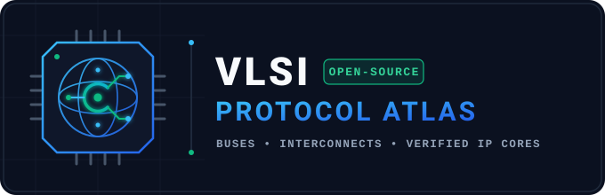

<p align="center">
  
</p>

<h1 align="center">VLSI Protocol Atlas & Open-Source IP Universe</h1>

<p align="center">
  <strong>Understand. Visualize. Verify.</strong> · <strong>Explore Silicon. Understand Architecture. Reverse Engineer IP.</strong>
</p>

<p align="center">
  <a href="#where-to-find-what--how-to-use">Where to Find What</a> •
  <a href="#features">Features</a> •
  <a href="#6-complete-mind-map-infinity-mesh-schematics--mini-map-navigation">Mind Map & Schematics</a> •
  <a href="#30-protocol-categories--16-master-knowledge-domains">Protocol Domains</a> •
  <a href="#3-rtl-design-systemverilog--uvm-curriculum-42-modules">RTL / SV / UVM</a> •
  <a href="#open-source-silicon-ip-universe">Open-Source IP Universe</a> •
  <a href="#quick-start">Quick Start</a> •
  <a href="#github-pages-deployment">GitHub Pages Deployment</a> •
  <a href="LICENSE">MIT License</a>
</p>

---

## Overview

**VLSI Protocol Atlas & Open-Source IP Universe** is an interactive semiconductor engineering documentation platform, cycle-accurate protocol simulator, RTL/SystemVerilog/UVM handbook, RTL reverse-engineering explorer, and UVM/SVA verification workbench.

Built for **RTL designers, SoC architects, design verification (DV) engineers, silicon bring-up teams, and students**, the platform connects:

- **498 Protocols & Standards** across **30 Categories** and **16 Master Knowledge Domains** (`100%` passing the 16-checkpoint specification audit)
- **42 Interactive RTL Design, SystemVerilog (IEEE 1800) & UVM (IEEE 1800.2) Modules** (14 per pillar) cross-linked to protocols and open-source RTL
- **37 Real Open-Source Silicon IPs** and **6 Reference SoC Topologies** (OpenTitan EarlGrey, Chipyard, PULPissimo, CVA6 SoC, LiteX, OpenPiton)
- **Complete Interactive Mind Map (Sections, Common & Merged)** uniting all 6 platform sections, 24 sub-branches, and 8 shared cross-cutting engineering foundations in one zoomable CAD workspace
- **Infinity-Mesh CAD Schematics & Interactive Mini-Map Overlays** powered by `react-zoom-pan-pinch` across Protocol Block/FSM Diagrams, SoC Explorer, IP Architectures, Knowledge Graph, and Mind Map
- **544 Interactive Hardware Explainers** powered by **14 Synchronized Visualization Renderers**
- **1,108-Node / 1,031-Edge Semiconductor Engineering Knowledge Graph** with shortest-path tracing, blast-radius analysis, natural-language queries, and live Verilog/SV repo ingestion
- **30-Subtopic AES 7-Chapter Hardware Security Deep Dive** (plus an interactive FIPS-197 AES-128 round stepper) and **28 Linked Silicon Glossary Terms**

Every protocol, IP, and explainer is structured across three engineering depth layers:

- **Level 1 — Fundamental Understanding:** First-principles intuition, design motivation, everyday analogies, step-by-step mental models, and common beginner misconceptions.
- **Level 2 — Engineering Mechanics:** Formal bus/datapath architecture, quantitative timing & bit-width math, worked cycle-by-cycle examples, and safe reset rules.
- **Level 3 — Expert Signoff (RTL / CDC / DV):** Synthesizable microarchitecture (skid buffers, Gray-coded async FIFOs, shadow registers), real-world *Symptom → Root Cause → Resolution* failure mode analysis, SystemVerilog Assertions (SVA), UVM verification hooks, and silicon debug playbooks.

---

## Where to Find What & How to Use

You can open the interactive **How to Use & Guide** page directly inside the web app from:
- The **Guide** button (`?`) in the top-right header utility bar
- The **How to Use & Guide** button in the Home Workspace Utility Strip or footer
- **Search Atlas** (`/` or `Cmd/Ctrl + K`) by typing `"guide"`, `"how to use"`, or `"where to find"`

### Workspace Directory Map

| Feature / Workbench | Where to Find It in the UI | How to Use It |
|---|---|---|
| **Complete Mind Map (Merged / Sections / Common)** | Header -> **Mind Map**, Home strip, Footer, or Search (`/`) | Switch between **Merged (All + Common)**, **All Sections (6 Pillars / 24 Branches)**, and **Common Bridges (8 shared concepts)**. Pan, zoom, jump via the Mini-Map, click any node to highlight cross-section bridges, or launch directly into linked Protocols, RTL/SV/UVM modules, and IPs. |
| **Platform Guide (Roadmap)** | Header right bar -> **Guide** (`?`), Home strip, Footer, or Search (`/`) | Browse role-based workflows, click-paths, tool playbooks, and keyboard shortcuts. |
| **Protocol Specs (498)** | Header -> **Protocol Atlas** (or Home 30-Domain Directory) | Pick any protocol in the left category tree, filter signals, pan/zoom **Infinity-Mesh Block & FSM Diagrams** with the mini-map, click any signal row or pinout chip to inspect RTL/SVA/UVM rules, switch **Focus Mode** (`All`, `RTL`, `UVM`, `Interview`), and compare Expected vs Bug waveforms. |
| **Waveform Studio** | Protocol Atlas sub-bar -> **Waveform Lab** (or Home card) | Select a bus (`AXI4`, `AXI4-Lite`, `AXI4-Stream`, `APB`, `SPI`, `I2C`, `UART`), inject backpressure stalls, step cycle-by-cycle, and check handshake violation flags. |
| **Compliance Checker** | Protocol Atlas sub-bar -> **Compliance Checker** (or Home card) | Load or edit cycle traces in JSON and run live AMBA / TileLink rule validation (`VALID/READY` stability, `WLAST`, 4KB boundaries). |
| **Protocol Compare & Bus Fabric Map** | Header -> **Compare** button; Protocol Atlas sub-bar -> **Protocol Compare** / **Bus Fabric Map** | Benchmark two protocols side-by-side (ordering, coherency, bursts, signal count) or explore the pannable CPU -> NoC -> DDR5/PCIe/RoT SoC fabric map. |
| **RTL Design Handbook (14)** | Header -> **RTL Design** (or Protocol Doc footer links) | Navigate chapters via the sticky left syllabus, study normative design rules and *Pitfall vs Verified Fix* cards, copy/export `.sv` snippets, and launch linked CDC/RTL labs. |
| **SystemVerilog IEEE 1800 (14)** | Header -> **SystemVerilog** (or RTL Design sub-bar) | Master 2-state vs 4-state types, interfaces/modports, clocking blocks, OOP & parameterized classes, constraints, covergroups, SVA sequences, event regions, and DPI-C. |
| **UVM Methodology IEEE 1800.2 (14)** | Header -> **UVM** (or RTL Design sub-bar) | Learn UVM topology, factory overrides, objections, virtual sequences, TLM ports, scoreboards, UVM RAL, `uvm_config_db`, and protocol agent patterns. |
| **RTL Explorer, CDC Analyzer & Verification Hub** | RTL Design sub-bar -> **RTL Source Explorer**, **Clock Domains (CDC)**, **UVM & SVA Gen**, **Verification Hub** | Inspect extracted RTL module trees, async FIFO / 2-FF / reset-bridge clock islands across IPs, generate parameterized SV interfaces/agents, and review `core_ibex` / `dvsim` / `cocotb` testbenches. |
| **Open-Source Silicon IP Universe (37)** | Header -> **IP Universe** (sub-tabs: **Processors**, **GPUs**, **AI Accelerators**, **IP Comparison**) | Filter CPUs, GPUs, AI accelerators, security cores, and interconnects; toggle between **IP Explorer** (pannable internal microarchitecture CAD schematic, modules, FSMs, CSR bit-fields) and **Protocol Explorer** (bus connectivity hub). |
| **SoC Explorer (6) & 16-Domain Atlas** | IP Universe sub-bar -> **SoC Explorer** / **16-Domain Atlas** | Pan/zoom EarlGrey, Chipyard, PULPissimo, CVA6 SoC, LiteX, and OpenPiton silicon topologies with the live Mini-Map navigator, plus browse ISA, packaging, physical design, DFT, and ISO 26262 domains. |
| **Knowledge Graph & Repo Ingestion** | IP Universe sub-bar -> **Knowledge Graph** / Home; Repo Ingestion via Search/Guide | Trace shortest paths and blast radius across 1,108 nodes & 1,031 edges with an interactive click-and-drag Mini-Map viewport indicator, run natural-language queries, export JSON/CSV/Markdown/Mermaid, or paste live Verilog/SV/Chisel RTL. |
| **Interactive Explainers (544)** | Header -> **Explainers** (or **Explainer** links on Home / Protocol cards) | Scrub timelines, toggle **Overview / Detail / Expert** live, enable **Verification View**, mutate signals with **Try It**, check **What Changes**, and complete 3-question self-checks. |
| **AES 7-Chapter Lab (30 Topics)** | Home -> **AES 7-Chapter Deep Dive** / Utility cards | Study GF(2⁸), S-Box, DOM masking, TL-UL integrity, TVLA/fault attacks, and step cycle-by-cycle through a live FIPS-197 AES-128 state matrix. |
| **Completeness Audit & Glossary** | Home Utility Strip / Footer -> **Completeness Audit**, **Glossary** | Verify 16-checkpoint `100%` documentation coverage across all 498 protocols and look up linked RTL/DV terminology. |

### Keyboard Shortcuts & Deep Links

- **`/` or `Cmd/Ctrl + K`** — Open **Search Atlas** across all 498 protocols, 42 RTL/SV/UVM modules, 37 IPs, RTL files, signals, SoCs, AES chapters, glossary, and Guide
- **`Esc`** — Close modals cleanly
- **`Space` / `←` / `→`** — Play/pause or step cycle-by-cycle inside the Interactive Hardware Explainer Studio
- **`#explainer/<topic>/s<scene>/t<step>`** — Bookmark or share an exact explainer topic, scene, and clock cycle
- **Focus Filter (`All Focus` | `RTL Focus` | `UVM Focus` | `Interview Prep`)** — Located in the Protocol Atlas sub-bar to emphasize matching protocol sections
- **Light / Dark Mode Toggle** — Top-right Sun/Moon icon switches CSS design tokens consistently across pages, waveforms, SVG FSMs, and code blocks

---

## Features

### 1. Interactive Hardware Explainer Studio (544 Topics · 14 Synchronized Renderers)
- **Unified Timeline & Deep-Link Engine (`#explainer/<topic>/s<scene>/t<step>`):** Synchronizes play/pause, cycle step (`←`/`→`), speed control, scrubbing, live **Overview / Detail / Expert** depth switching, **Verification View**, interactive **"Try It"** mutations, **"What Changes"** diff tables, and **3-question self-checks**.
- **14 Data-Driven Visualization Renderers:** Block Packet Flows, Sequence Diagrams, Cycle-Accurate Waveforms, FSM State Graphs, Live Hex Bit-Field Decoders, CPU/GPU Pipeline Lanes (forwarding/stalls/flushes), SoC Memory Map & Page Walk, UPF/Clock/Reset Floorplan Overlays, 60fps Systolic Array Canvas (`WS`/`OS`/`RS`), MESI Cache Coherence, 60fps 2D NoC Mesh Canvas, Queue/Credit Meters, Roofline Performance Charts, and Layered Encapsulation Stacks.
- **Built-In Schema Validator & Authoring Guide:** Runtime `validateTopic()` verification enforces citations, accessibility `ariaDescription`, 3 depth layers, and 3-question self-checks on every topic.

### 2. Protocol Atlas (498 Protocols & Standards Across 30 Domains)
- **Version & Specification Inspector:** Mandatory `revision` and `officialSpecificationUrl` metadata rendered directly in the right-hand sticky metadata inspector (`Version & Specification`) with verified external specification links.
- **Protocol-to-RTL Signal Inspector:** Click any signal row or right-rail pinout chip to scroll smoothly to the Signal Inspector drawer and review width, direction, polarity, reset value, timing rules, legal/illegal handshake conditions, synthesizable SystemVerilog snippets, SVA properties, and UVM driver notes.
- **Interactive Waveform Studio:** Step cycle-by-cycle through live bus handshakes (`AXI4`, `AXI4-Lite`, `AXI4-Stream`, `APB`, `SPI`, `I2C`, `UART`), inject backpressure stalls, track hovered cycle coordinates accurately, and inspect handshake violations (including TileLink `a_valid`/`a_ready` & `d_valid`/`d_ready`).
- **Compliance Checker:** Validate transaction traces against AMBA and TileLink integrity invariants with proper 1-bit binary flag rendering (`PWRITE`, `PSLVERR`) and bus waveforms.
- **Protocol Compare & Bus Fabric Map:** Side-by-side throughput, burst, ordering, coherency, and signal matrices plus SoC-wide interconnect topology maps.
- **UVM & SVA Generator:** Generate parameterized SystemVerilog interfaces, assertions, and verification templates.

### 3. RTL Design, SystemVerilog & UVM Curriculum (42 Modules)
- **RTL Design (14 Modules):** Synthesizable coding rules (`always_ff`/`always_comb`), blocking vs non-blocking rules, safe FSM encoding & recovery, elastic `valid/ready` skid buffers, Gray-coded async FIFOs, reset synchronizer bridges, fixed-priority & round-robin arbitration, datapath pipelining, fixed-point arithmetic, SRAM & register-file inference, ICG low-power clock gating, synthesis-vs-simulation mismatches, and STA timing closure.
- **SystemVerilog — IEEE 1800 (14 Modules):** 2-state vs 4-state semantics, packed/unpacked arrays, queues & associative arrays, interfaces & modports, clocking blocks, OOP & parameterized classes, constrained randomization & weights, functional covergroups & cross coverage, immediate & concurrent SVA assertions, event scheduling regions, `fork/join` synchronization, and DPI-C.
- **UVM Methodology — IEEE 1800.2 (14 Modules):** Testbench hierarchy & factory overrides, run phases & objection lifecycle, `uvm_sequence_item` & sequence arbitration, virtual sequences, active/passive drivers & monitors, TLM FIFOs & analysis ports, self-checking scoreboards, functional coverage subscribers, UVM RAL register abstraction, `uvm_config_db` scoping, and reusable AXI/TileLink agent patterns.

### 4. Semiconductor Engineering Knowledge Graph & Repo Ingestion
- **Unified Graph Engine (1,108 Nodes, 1,031 Edges):** Links 15 entity types across Protocols, Hardware IPs, Processors, SoCs, RTL Modules, Signals, UVM Components, Testcases, Assertions, Standards, Registers, Memory, Clock/Reset Domains, and EDA Tools with shortest-path BFS tracing, blast-radius analysis, natural-language queries, and JSON/CSV/Markdown/Mermaid export.
- **Live RTL Repository Ingestion:** Parse Verilog/SystemVerilog/Chisel snippets or upload modules to auto-patch the Knowledge Graph live.

### 5. Open-Source Silicon IP Universe (Dual Explorer Architecture)
Every silicon IP includes both:
1. **IP Explorer:** Submodule RTL trees, internal block diagrams, extracted FSM state diagrams, CSR register maps (`HJSON / reggen` bit fields), compile-time parameters, clocking/reset architecture, and upstream verification commands.
2. **Protocol Explorer:** Interactive SVG bus connectivity hub linking external ports (`OBI`, `AXI4`, `AXI4-Lite`, `TL-UL`, `RoCC`, `PCIe`, `I2C`, `UART`) directly into their protocol specs.

### 6. Complete Mind Map, Infinity-Mesh Schematics & Mini-Map Navigation
- **Complete Mind Map (`MindMapView`):** Switch seamlessly between **Merged (All + Common)**, **All Sections (6 Pillars & 24 Sub-Branches)**, and **Common Bridges (8 Shared Engineering Foundations)** with interactive node inspection, a **Common Engineering Crosswalk Matrix**, and direct 1-click links into Protocols, RTL/SV/UVM modules, and Silicon IPs.
- **Infinity-Mesh CAD Viewports (`InfiniteMeshViewport`):** 3-tier vector engineering grid (`8px` / `32px` / `160px` + precision crosshairs) backed by Light/Dark CSS variables and smooth `react-zoom-pan-pinch` pan, pinch/Ctrl+Wheel zoom, wheel-lock toggle, fit-to-view, and expandable canvas workspace.
- **Interactive Mini-Map Navigator Overlays:** Real-time topology thumbnail with domain-colored block/edge footprints, live viewport position indicator (`ResizeObserver` synced), click-and-drag jump-to-section, **Center** action, and **Map** visibility toggle across SoC Explorer, SoC Connectivity Map, Knowledge Graph, IP Architectures, Protocol Block/FSM diagrams, and Mind Map.

### 7. Specialized Silicon Engineering Labs
- **Clock Domain Analysis (CDC) Tool:** Maps clock islands, reset domains, asynchronous crossings, and synchronizer insertion points (`2-FF`, Gray async FIFOs, reset bridges) across multi-clock IPs.
- **AES 7-Chapter Deep Dive & Interactive FIPS-197 Lab:** Full 30-subtopic hardware security curriculum covering GF(2⁸) finite fields, SubBytes/ShiftRows/MixColumns/KeyExpansion, DOM masking countermeasures, `TL-UL` integrity, TVLA/fault injection, and an interactive cycle-by-cycle AES-128 state matrix stepper.
- **Documentation Completeness Dashboard:** Live 16-checkpoint **MASTER INSTRUCTION** audit tracking Fundamentals, Architecture, Specifications, Signals, Transactions, Timing, RTL Hierarchy, Internal Modules, Registers, Parameters, Verification, Assertions, Coverage, Debugging, Corner Cases, and Primary Citations (`100%` pass rate across all 498 protocols and 37 IPs).
- **Semiconductor Glossary & Feeling Lucky Discovery:** Linked 3-level glossary (`28` terms) plus non-repeating **Feeling Lucky** random discovery across protocols, silicon IPs, AES chapters, CDC labs, and simulators.

---

## 30 Protocol Categories & 16 Master Knowledge Domains

| # | Domain | Representative Standards & Buses |
|---|---|---|
| 1 | **ARM AMBA On-Chip** | AXI3, AXI4, AXI4-Lite, AXI4-Stream, AXI5, AHB, AHB5, APB2–5, ACE, ACE5, CHI-E, ATB, CXS, DTI, LTI, Q/P-Channel |
| 2 | **Open & Custom On-Chip Buses** | TileLink (UL/UH/UD/C), Wishbone Classic/B4, OBI, OCP, CoreConnect (PLB/OPB/DCR), Avalon-MM/ST, PULP AXI |
| 3 | **Processor & Coprocessor Interfaces** | RISC-V External Debug/DMI/Trace, CV-X-IF, RoCC, OBI, QPI, UPI, HyperTransport |
| 4 | **Cache Coherency & Accelerators** | MSI, MESI, MOSI, MOESI, MESIF, ACE, CHI-E, TileLink-C, CXL.io/cache/mem, CCIX, OpenCAPI, NVLink/NVLink-C2C, Infinity Fabric |
| 5 | **Memory & Storage Interfaces** | SDR/DDR/DDR2–5, LPDDR3–5X, MRDIMM/RDIMM/LRDIMM, GDDR5–7, HBM2E/3/4, DFI 3–5, ONFI, Toggle NAND, QSPI/OSPI, UFS, NVMe |
| 6 | **High-Speed Serial & PCIe Sub-Layers** | PCIe Gen1–7 (Transaction/DLL/PHY, TLP/DLLP, FLIT, LTSSM, SR-IOV, ATS/PRI/PASID, AER), USB4, Ethernet 1G–800G |
| 7 | **Chip-to-Chip & Die-to-Die (D2D)** | UCIe, CXL 1.1–3.1 (HDM Decoders, Fabric Manager), Bunch of Wires (BoW), AIB, XSR/USR SerDes |
| 8 | **Network-on-Chip (NoC)** | AXI NoC, AMBA CHI Mesh, TileLink Fabric, OpenPiton NoC, Wormhole/VC Packet Routing |
| 9 | **Peripheral & Low-Speed Buses** | UART, SPI, Quad/Octal SPI, I2C, SMBus, PMBus, I3C (SPD), CAN/CAN-FD/XL, LIN, FlexRay, I2S, PDM, GPIO, 1-Wire |
| 10 | **Display, Camera & Sensor PHY** | MIPI CSI-2, DSI-2, D-PHY, C-PHY, M-PHY, UniPro, RFFE, eDP, DisplayPort, HDMI, SLVS-EC |
| 11 | **Debug, Trace & Functional Safety** | JTAG (1149.1), cJTAG (1149.7), SWD, CoreSight ETM/ITM/STM, ISO 26262 Lockstep/DCLS, BIST/MBIST/LBIST, IJTAG (1687) |
| 12 | **Hardware Security, CDC & Signoff** | TL-UL Integrity (Hsiao SECDED), OpenTitan KeyMgr/CSRNG/HSM, Caliptra, DICE, SPDM, UPF (1801), CDC/RDC, SVA/UVM/Formal |

---

## Open-Source Silicon IP Universe

Included hardware IPs and SoCs trace directly to authoritative open-source silicon projects:

- **Processors:** `lowRISC Ibex`, `OpenHW CVA6 (Ariane)`, `CV32E40P`, `UC Berkeley Rocket Chip`, `SonicBOOM`, `VexRiscv`, `SERV`, `PicoRV32`
- **GPUs & AI Accelerators:** `Vortex GPGPU`, `MIAOW GPU`, `Nyuzi GPU`, `Berkeley Gemmini`, `NVIDIA NVDLA`, `PULP RedMulE`
- **Security & Root of Trust:** `OpenTitan AES` (DOM masked), `HMAC`, `KMAC`, `OTBN`, `CSRNG`, `KeyMgr`, `Alert Handler`, `ROM/SRAM/Flash Controllers`
- **Interconnects, Memory & Peripherals:** `PULP AXI`, `OpenTitan TL-UL Xbar`, `OpenPiton NoC`, `LiteDRAM`, `Verilog-AXI`, `Verilog-PCIe`, `Verilog-Ethernet`, `UltraEmbedded USB`, `OpenTitan UART / SPI Host / I2C / GPIO / PLIC`
- **Reference SoCs:** OpenTitan EarlGrey, Chipyard, PULPissimo, CVA6 SoC, LiteX SoC, OpenPiton Manycore

---

## Tech Stack

- **Frontend:** React 19, TypeScript 7, Tailwind CSS v4 (`@tailwindcss/vite`), `react-zoom-pan-pinch`, Lucide Icons, Motion
- **Build & Tooling:** Vite 8, `esbuild` 0.28, `tsx`, TypeScript typechecker (`tsc --noEmit`)
- **Deployment:** Static production bundle with automated GitHub Actions Pages CI/CD

---

## Project Structure

```text
├── .github/workflows/
│   └── deploy.yml                     # Automated GitHub Actions build & GitHub Pages deploy
├── public/assets/aistudio/
│   └── gemini-svg_07b7b86a.svg        # Official VLSI Protocol Atlas SVG brand logo (README only)
├── src/
│   ├── engine/
│   │   ├── explainerSchema.ts         # Hardware explainer schema, semantic legend & validateTopic()
│   │   └── useTimelineController.ts   # Shared playback, scrubbing, keyboard & hash deep-link hook
│   ├── components/
│   │   ├── explainer/                 # Interactive Explainer Studio + all 14 synchronized renderers
│   │   ├── InfiniteMeshViewport.tsx   # Pan/zoom CAD viewport (react-zoom-pan-pinch) + Infinity-Mesh + Mini-Map
│   │   ├── MindMapView.tsx            # Unified Mind Map (All Sections, Common Bridges & Merged view)
│   │   ├── PlatformGuideView.tsx      # "How to Use What & Where to Find Everything" guide page
│   │   ├── RtlSvUvmStudioView.tsx     # 42-module RTL Design, SystemVerilog & UVM interactive studio
│   │   ├── ProtocolDocView.tsx        # Protocol Docs, Signal Inspector drawer, waveforms & assertions
│   │   ├── WaveformViewer.tsx         # Interactive bus/bit waveform viewer & violation detector
│   │   ├── DiagramViewers.tsx         # Infinity-Mesh SVG Block Diagram, FSM Graph & exportable CodeBlock
│   │   ├── TechnicalVisualizers.tsx   # Packet Layer Stack & Register Memory Map visualizers
│   │   ├── SimulatorLab.tsx           # Interactive cycle-accurate protocol waveform simulator
│   │   ├── ComplianceChecker.tsx      # AMBA / TileLink protocol trace invariant checker
│   │   ├── KnowledgeGraphView.tsx     # 1,108-node Knowledge Graph explorer + interactive Mini-Map & pathfinder
│   │   ├── SocExplorerView.tsx        # Multi-SoC topology schematics + interactive Mini-Map
│   │   ├── SocMapAndUvm.tsx          # SoC Bus Fabric Map + UVM & SVA code generator
│   │   ├── DocumentationCompletenessDashboard.tsx
│   │   ├── MasterArchitectureView.tsx
│   │   ├── IpDetailView.tsx           # Dual IP Explorer / Protocol Explorer with CAD schematics
│   │   ├── SearchModal.tsx            # Global search across protocols, IPs, RTL/SV/UVM, Mind Map, glossary & guide
│   │   └── ...
│   ├── data/
│   │   ├── explainers/                # 544 explainer topics + TOPIC_TEMPLATE
│   │   ├── protocols/                 # 498 protocols & standards + specificationMetadata.ts
│   │   ├── ips/                       # 37 open-source silicon IP profiles
│   │   ├── socs/                      # 6 SoC integration topologies
│   │   ├── rtlSvUvmCurriculum.ts      # 42 structured RTL Design, SystemVerilog & UVM modules
│   │   ├── knowledgeGraphEngine.ts    # 1,108-node graph builder, BFS pathfinder & NL queries
│   │   └── glossary.ts                # Multi-layer VLSI & verification terminology
│   ├── App.tsx                        # Header navigation, workspace sub-bars, router & theme state
│   ├── index.css                      # Light/Dark CSS tokens, Infinity-Mesh variables & scrollbar styles
│   └── main.tsx
├── index.html
├── vite.config.ts
├── package.json
└── LICENSE                            # MIT License
```

---

## Quick Start

### Prerequisites
- **Node.js** `>= 20` (tested on Node 22)
- **npm** `>= 10`

### Installation & Local Development

```bash
# 1. Clone the repository
git clone https://github.com/<your-org>/vlsi-protocol-atlas.git
cd vlsi-protocol-atlas

# 2. Install dependencies
npm install

# 3. Start the local development server on port 3000
npm run dev
```

### Typecheck & Production Build

```bash
# Run TypeScript static verification
npm run lint

# Build optimized static output into dist/
npm run build

# Preview production bundle locally
npm run preview
```

---

## GitHub Pages Deployment

This project is a Vite + TypeScript React SPA, so **raw repository source (`index.html` referencing `/src/main.tsx`) cannot be served directly by GitHub Pages**—GitHub Pages must serve the **compiled `./dist` bundle**.

### Option A: Automated GitHub Actions Deployment (Recommended)

This repository includes `.github/workflows/deploy.yml` configured with `enablement: true`, `NODE_ENV=production`, and automatic `VITE_BASE_PATH` resolution (falling back to `/<repo-name>/` or `/` for user sites, and `./` for local subpath-agnostic static builds).

1. **Set GitHub Pages Source to GitHub Actions:**
   - Open your GitHub repository → **Settings → Pages → Build and deployment → Source**
   - Select **GitHub Actions** (do **NOT** select *Deploy from a branch -> main*, or browsers will 404 on `/src/main.tsx`).
2. **Allow Workflow Permissions:**
   - Go to **Settings → Actions → General → Workflow permissions**
   - Select **Read and write permissions** and click **Save**.
3. **Trigger the Deployment:**
   - Push to `main` or `master`, **or** go to **Actions → Deploy to GitHub Pages → Run workflow**.
   - Wait for both **Build Static Bundle** and **Deploy to GitHub Pages** jobs to finish green. Your live URL will appear inside the **Deploy to GitHub Pages** job summary (`https://<username>.github.io/<repo-name>/`).

### Option B: Manual Branch Deploy (`gh-pages` branch)

If you prefer deploying without GitHub Actions:

```bash
# Build production output with subpath (replace <repo-name> with your GitHub repo name)
VITE_BASE_PATH=/<repo-name>/ npm run build
touch dist/.nojekyll
cp dist/index.html dist/404.html

# Publish dist/ to the gh-pages branch
npx gh-pages -d dist
```

Then go to **Settings → Pages → Build and deployment → Source → Deploy from a branch**, select **`gh-pages`** and **`/ (root)`**, and click **Save**.

### Local Subpath Verification Before Pushing

Test the exact GitHub Pages subpath locally before pushing:

```bash
VITE_BASE_PATH=/vlsi-protocol-atlas/ npm run build
npx vite preview --port 4173 --base /vlsi-protocol-atlas/
# Open http://localhost:4173/vlsi-protocol-atlas/
```

### Troubleshooting GitHub Pages

| Symptom | Root Cause | Fix |
|---|---|---|
| **Blank white page & 404 on `/src/main.tsx`** | GitHub Pages is set to *Deploy from a branch -> `main`* instead of the compiled bundle. | Switch **Settings → Pages → Source** to **GitHub Actions** (or deploy `dist/` to `gh-pages`). |
| **Blank page & 404 on `/assets/*.js`** | Asset base path mismatch on project subpath (`/<repo-name>/`). | Pull latest `vite.config.ts` and `.github/workflows/deploy.yml` (`VITE_BASE_PATH` is auto-derived from the repository name). |
| **`actions/configure-pages` fails (404 / Not Found)** | GitHub Pages was never enabled or workflow lacks permissions. | Enable **Read and write permissions** under **Settings → Actions → General** and set **Settings → Pages → Source** to **GitHub Actions**. |
| **Workflow never runs on push** | Default branch is neither `main` nor `master`. | Add your branch under `on.push.branches` in `.github/workflows/deploy.yml` or trigger manually via **Run workflow**. |

---

## Authoritative Sources & Attributions

Technical documentation and hardware architectures synthesize public specifications and open-source RTL repositories from:
- **Standards Bodies:** Arm AMBA Specifications, PCI-SIG, JEDEC, MIPI Alliance, USB-IF, RISC-V International, Open Compute Project (OCP), IEEE Standards Association (`1800`, `1800.2`, `1801`, `1149.1`, `1687`, `802.3`), and OpenTitan Documentation.
- **Open-Source Silicon Projects:** lowRISC OpenTitan & Ibex, OpenHW Group (CVA6 / CORE-V), ETH Zurich & University of Bologna (PULP Platform), UC Berkeley (Rocket Chip, BOOM, Gemmini), Georgia Tech (Vortex GPGPU), Princeton (OpenPiton), Enjoy-Digital (LiteX), Alex Forencich (`verilog-axi`, `verilog-pcie`, `verilog-ethernet`), and YosysHQ (`PicoRV32`).

---

## License

Released under the **[MIT License](LICENSE)**.
